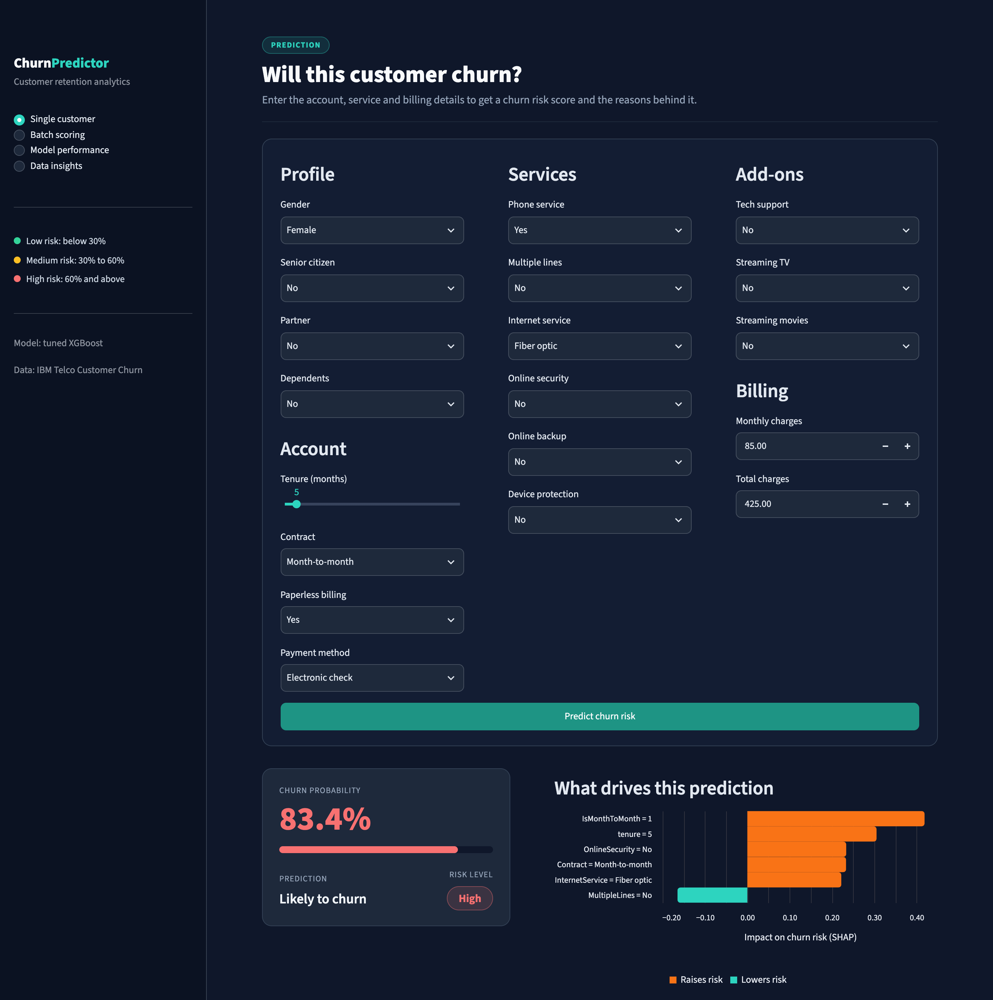
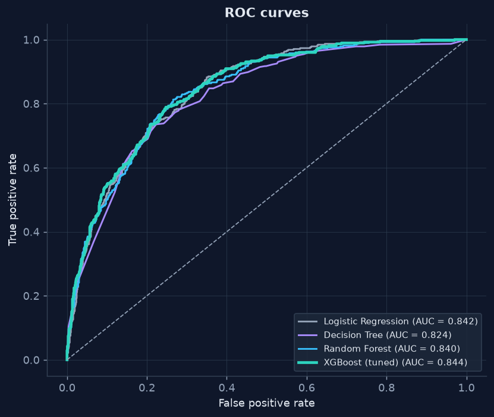
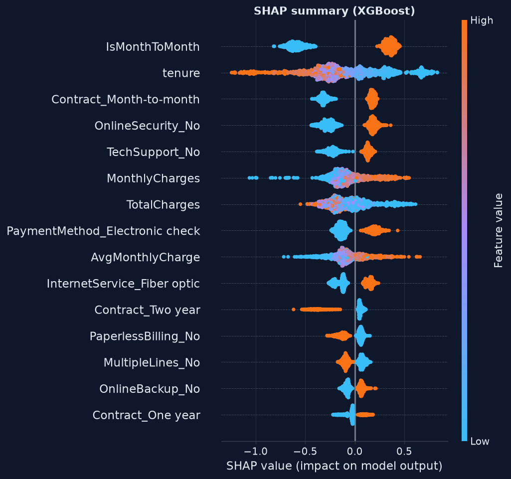
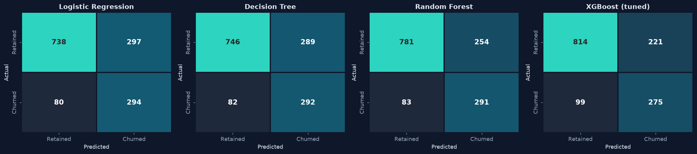
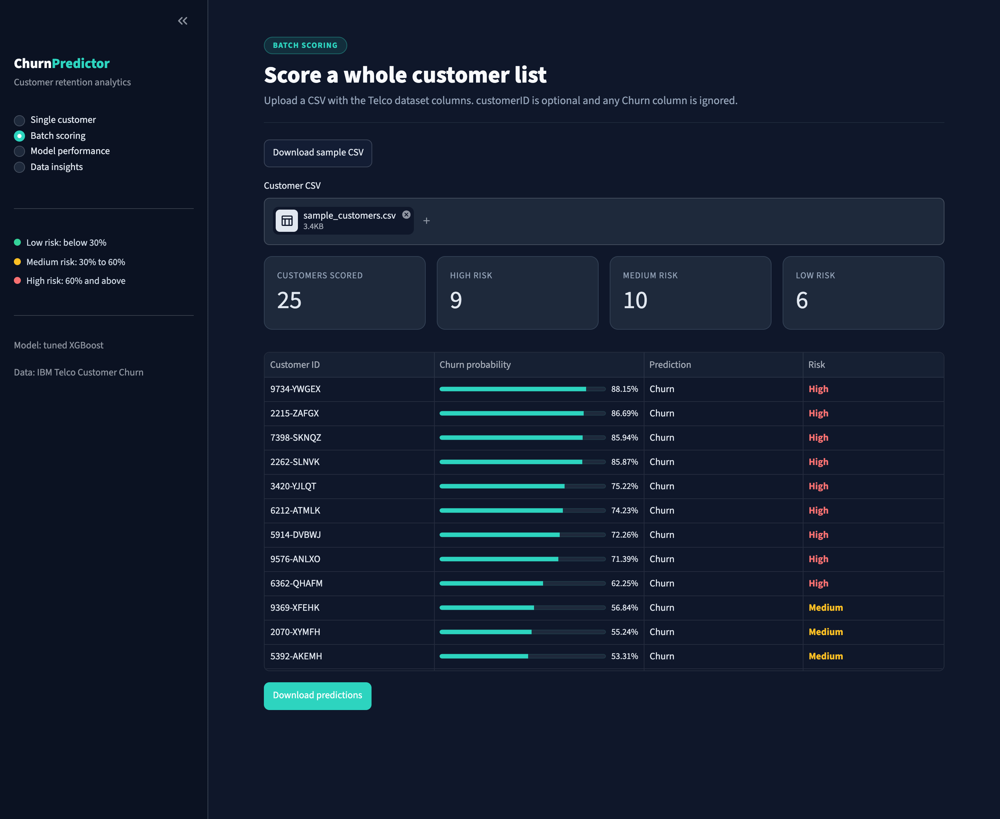
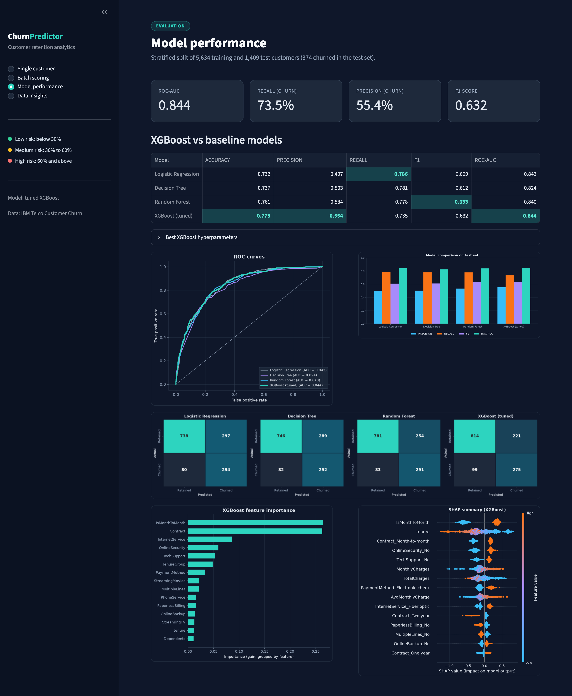
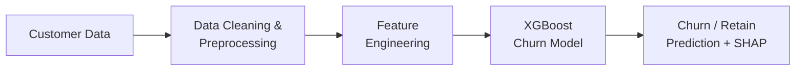
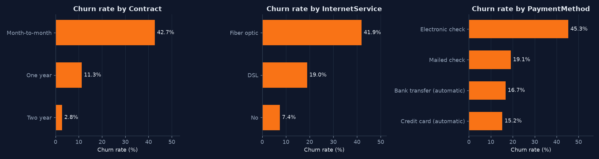

<div align="center">

# AI-Based Customer Churn Prediction

**Predict which customers are about to leave, how likely it is, and why.**

A complete machine-learning pipeline that uses a tuned **XGBoost** model with **SHAP** explanations, served through an interactive **Streamlit** dashboard.




</div>

---

## Contents

- [Overview](#overview)
- [Key results](#key-results)
- [Dashboard](#dashboard)
- [How it works](#how-it-works)
- [Dataset](#dataset)
- [Quick start](#quick-start)
- [Project structure](#project-structure)
- [Team](#team)
- [References](#references)

---

## Overview

Losing a customer costs far more than keeping one, and the warning signs are easy to miss in large volumes of account data. This project classifies telecom customers as **likely to churn** or **likely to stay**:

- Gives a **churn probability** and a **Low / Medium / High** risk category for each customer
- Explains every prediction with **SHAP**, showing which factors push a customer toward leaving
- Handles **class imbalance** (only 26.5 % of customers churn) with class weighting
- Compares XGBoost against **Logistic Regression, Decision Tree and Random Forest** baselines
- Judges models on **precision, recall, F1 and ROC-AUC**, not misleading accuracy alone

> Built as **Project-II (AIML, 7th Semester)** at the School of Engineering & Technology, CGC University, Mohali.

---

## Key results

Evaluated on a held-out, stratified test set of **1,409 customers** (374 churned):

| Model | Accuracy | Precision | Recall | F1 | ROC-AUC |
|---|:-:|:-:|:-:|:-:|:-:|
| Logistic Regression | 0.732 | 0.498 | **0.786** | 0.609 | 0.842 |
| Decision Tree | 0.737 | 0.503 | 0.781 | 0.612 | 0.824 |
| Random Forest | 0.761 | 0.534 | 0.778 | **0.633** | 0.840 |
| **XGBoost (tuned)** | **0.773** | **0.554** | 0.735 | 0.632 | **0.844** |

- **XGBoost** has the best ROC-AUC, accuracy and precision. Random Forest is level on F1.
- A naive "nobody churns" model would score 73.5 % accuracy but catch **zero** churners. That is why recall and F1 matter here.
- **Top churn drivers:** month-to-month contracts, short tenure, no online security or tech support, fiber-optic internet and electronic-check payment.

<p align="center">
  
  
</p>

<p align="center">
  
</p>

---

## Dashboard

| Batch scoring | Model performance |
|---|---|
|  |  |

The dashboard has four pages:

1. **Single customer:** enter details and get the churn probability, risk category and top SHAP factors.
2. **Batch scoring:** upload many customers and download a ranked risk list.
3. **Model performance:** comparison table, ROC curves, confusion matrices, feature importance and SHAP.
4. **Data insights:** dataset facts and exploratory charts.

---

## How it works



1. **Preprocessing:** converts `TotalCharges` to numbers (11 blanks for new customers are filled with 0), checks for duplicates, one-hot encodes categorical columns and scales numeric ones.
2. **Feature engineering:** adds `TenureGroup`, `AvgMonthlyCharge`, `NumServices`, `HasFamily`, `IsMonthToMonth` and `AutoPayment`.
3. **Imbalance handling:** uses `class_weight="balanced"` for the baselines and a tuned `scale_pos_weight` for XGBoost.
4. **Tuning:** runs `RandomizedSearchCV` (40 candidates, 5-fold stratified CV, refit on F1) over `max_depth`, `learning_rate`, `n_estimators`, `scale_pos_weight`, `subsample`, `colsample_bytree` and `min_child_weight`.
5. **Explainability:** shows XGBoost feature importance, a global SHAP summary and per-customer SHAP factors.

---

## Dataset

[IBM Telco Customer Churn](https://github.com/IBM/telco-customer-churn-on-icp4d/blob/master/data/Telco-Customer-Churn.csv) (also on Kaggle as *Telco Customer Churn*).

| Records | Columns | Churned | Retained | Churn rate |
|:-:|:-:|:-:|:-:|:-:|
| 7,043 | 21 | 1,869 | 5,174 | 26.54 % |

<p align="center">
  
</p>

---

## Quick start

```bash
git clone https://github.com/charanpreetSingh123/AI-Customer-Churn-Prediction.git
cd AI-Customer-Churn-Prediction

python -m venv .venv
source .venv/bin/activate        # Windows: .venv\Scripts\activate
pip install -r requirements.txt

streamlit run app.py             # opens http://localhost:8501
```

The trained model is already included. To reproduce everything from scratch:

```bash
python src/eda.py      # dataset summary + EDA charts
python src/train.py    # train, tune, evaluate, save model + figures
```

> **macOS:** XGBoost needs OpenMP. Run `brew install libomp` once if you see a `libomp.dylib` error.

---

## Project structure

```
├── app.py                      # Streamlit dashboard
├── .streamlit/config.toml      # dark theme
├── requirements.txt
├── data/
│   ├── Telco-Customer-Churn.csv
│   └── sample_customers.csv    # 25 rows to try batch upload
├── models/
│   └── churn_model.joblib      # preprocessing + tuned XGBoost pipeline
├── reports/
│   ├── metrics.json            # all evaluation results
│   ├── model_comparison.csv
│   ├── dataset_summary.json
│   └── figures/                # ROC, confusion matrices, SHAP, EDA charts
├── docs/screenshots/           # dashboard screenshots
└── src/
    ├── preprocess.py           # cleaning, feature engineering, encoders
    ├── eda.py                  # exploratory data analysis
    ├── train.py                # training, tuning, evaluation, SHAP
    ├── predict.py              # scoring, risk category, explanations
    └── style.py                # shared colour palette for charts
```

---

## Team

| Name | Roll No. |
|---|---|
| Vishesh Kumar | 2330666 |
| Ankita Kumari | 2330604 |
| Aarohan | 2330607 |
| Charanpreet Singh | 2330613 |

**Guide:** Mr. Gourav (Assistant Professor), Department of Artificial Intelligence & Data Science, CGC University, Mohali | Academic Year 2026-2027

---

## References

1. T. Chen and C. Guestrin, "XGBoost: A Scalable Tree Boosting System," *KDD*, 2016.
2. A. Dal Pozzolo et al., "Calibrating Probability with Undersampling for Unbalanced Classification," *IEEE SSCI*, 2015.
3. L. Breiman, "Random Forests," *Machine Learning*, 45(1), 2001.
4. F. Pedregosa et al., "Scikit-learn: Machine Learning in Python," *JMLR*, 12, 2011.
5. S. M. Lundberg and S.-I. Lee, "A Unified Approach to Interpreting Model Predictions," *NeurIPS*, 2017.

<div align="center">

If you found this project useful, consider giving it a star.

</div>
